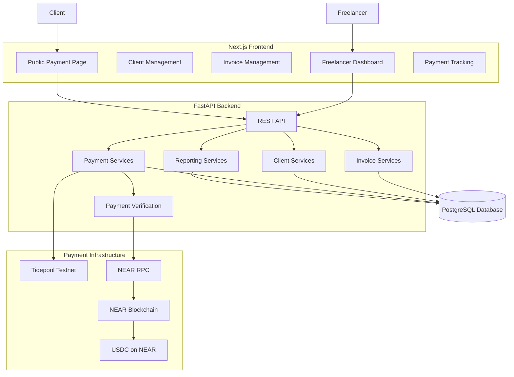
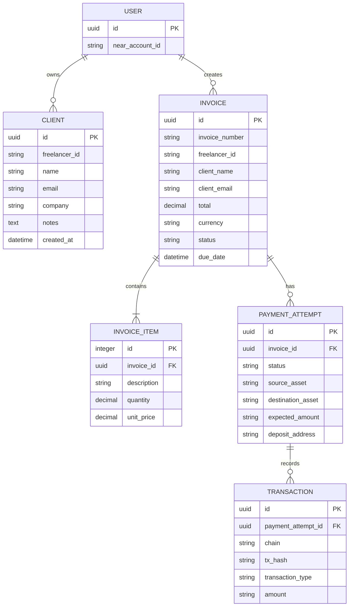
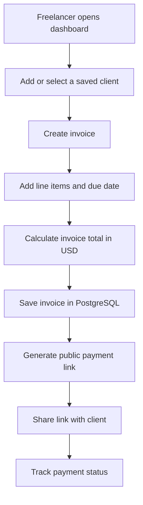
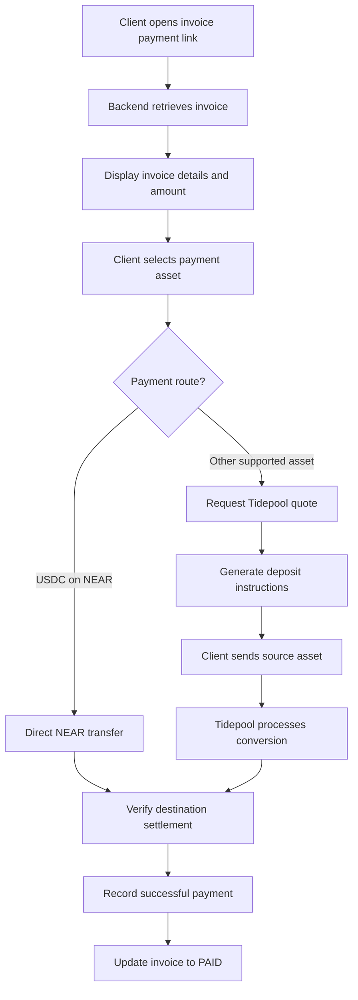
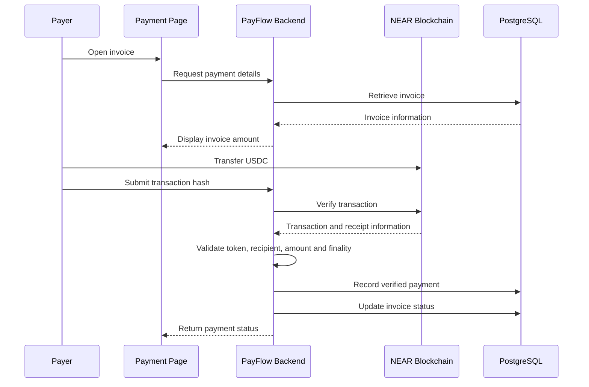
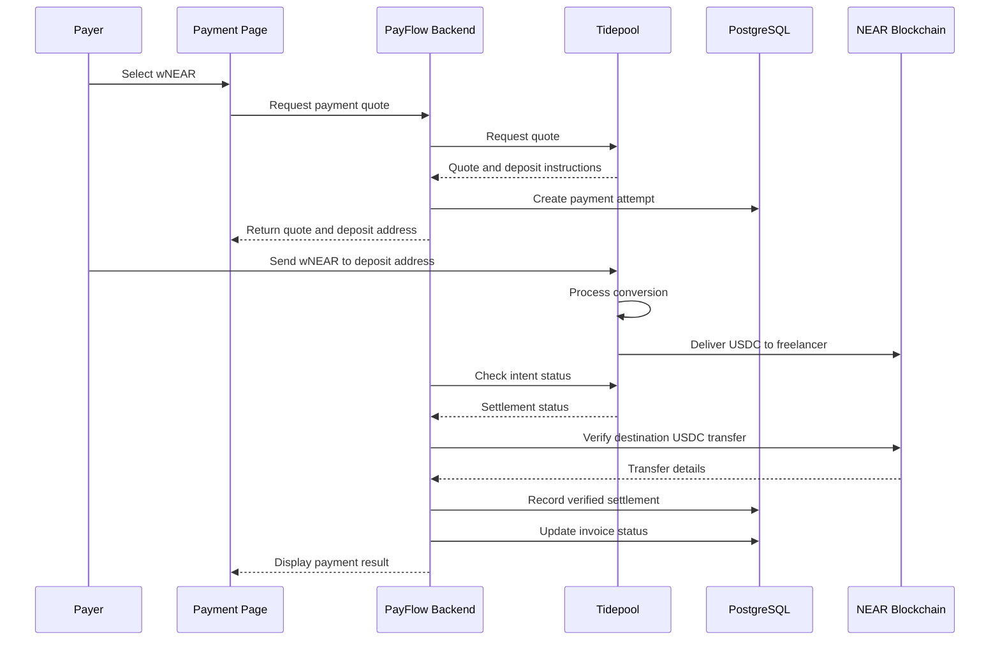

# PayFlow — Project Documentation

**Cross-chain invoicing with USDC settlement on NEAR**

Version: 1.0  
Project: Hackathon Track 08 — Real-World Money  
Status: Working prototype

---

# 1. Project Overview

## 1.1 What is PayFlow?

PayFlow is a crypto-powered invoicing platform designed for freelancers who don't want to deal with the complexity of cryptocurrency.

A freelancer creates an invoice denominated in USD and shares a payment link with their client. The client can pay using supported cryptocurrencies from different chains, while the freelancer receives USDC on the NEAR blockchain.

The freelancer does not need to understand cross-chain bridges, token swaps, or blockchain-specific payment processes.

PayFlow handles the payment routing and conversion behind the scenes.

## 1.2 Problem Statement

Freelancers working internationally often face difficulties receiving payments:

- Traditional international transfers can be expensive and slow.
- Clients and freelancers may use different payment networks.
- Cryptocurrency payments introduce complexity around wallets, tokens, and chains.
- Cross-chain transfers require additional infrastructure.
- Freelancers may not want to manage multiple cryptocurrencies.

## 1.3 Solution

PayFlow provides:

- USD-denominated invoice creation.
- Client management and reusable client records.
- Shareable public invoice payment pages.
- Support for different payment assets.
- Cross-chain conversion into USDC on NEAR.
- Payment tracking and invoice status management.
- A unified dashboard for invoices, clients, and payments.

## 1.4 Core Principle

**The client pays with what they have. The freelancer receives what they want.**

| Role | Experience |
|---|---|
| Freelancer | Creates USD invoices and receives USDC |
| Client | Pays using a supported token and chain |
| PayFlow | Handles payment routing, conversion, and tracking |

---

# 2. Technology Stack

## Frontend

| Technology | Purpose |
|---|---|
| Next.js 16 | Frontend framework |
| React 19 | UI components |
| TypeScript | Type safety |
| Tailwind CSS 4 | Styling |
| Next.js App Router | Page routing |

## Backend

| Technology | Purpose |
|---|---|
| Python | Backend language |
| FastAPI | REST API framework |
| SQLAlchemy | ORM and database operations |
| Pydantic | Request and response validation |
| PostgreSQL | Persistent database |

## Blockchain and Payment Infrastructure

| Technology | Purpose |
|---|---|
| NEAR Protocol | Destination settlement blockchain |
| USDC on NEAR | Freelancer settlement currency |
| Tidepool | Testnet cross-chain payment and conversion infrastructure |
| NEAR RPC | Blockchain transaction verification |
| Rust | NEAR smart contract development |
| NEP-366 | Meta-transaction infrastructure / relayer support |

**Important:** The current Tidepool integration uses its testnet sandbox and test tokens. These tokens have no monetary value. Tidepool is being used as a 1Click-compatible test environment, not as an official NEAR or Defuse service.

---

# 3. System Architecture

PayFlow follows a frontend-backend architecture with a PostgreSQL database and external blockchain/payment infrastructure.

## 3.1 High-Level Architecture



## 3.2 Component Responsibilities

### Frontend

The frontend provides the user-facing interface.

Its responsibilities include:

- Displaying freelancer dashboard statistics.
- Creating and managing invoices.
- Managing saved clients.
- Displaying public payment pages.
- Allowing clients to select supported payment assets.
- Displaying payment status and transaction information.
- Displaying reports and payment history.

### Backend

The backend handles business logic and communication with external services.

Its responsibilities include:

- Creating invoices.
- Managing client records.
- Calculating and storing invoice totals.
- Creating payment attempts.
- Requesting payment quotes and deposit instructions.
- Communicating with Tidepool.
- Interacting with NEAR RPC.
- Tracking payment and invoice statuses.
- Producing reporting data.

### PostgreSQL

PostgreSQL stores the application's persistent data.

It contains records for:

- Users/freelancers.
- Clients.
- Invoices.
- Invoice items.
- Payment attempts.
- Blockchain transactions.

### Blockchain Infrastructure

The payment infrastructure handles asset transfers and conversion.

For direct NEAR USDC payments, the client transfers USDC directly to the freelancer.

For cross-chain payments, Tidepool provides the deposit instructions and handles the conversion into destination USDC.

---

# 4. Application Structure

The project is divided into frontend, backend, and blockchain contract components.

```text
payflow/
│
├── frontend/
│   ├── app/
│   │   ├── dashboard/
│   │   │   ├── page.tsx
│   │   │   ├── clients/
│   │   │   │   └── page.tsx
│   │   │   ├── invoices/
│   │   │   │   ├── page.tsx
│   │   │   │   ├── new/
│   │   │   │   │   └── page.tsx
│   │   │   │   └── [id]/
│   │   │   │       └── page.tsx
│   │   │   ├── payments/
│   │   │   │   └── page.tsx
│   │   │   └── reports/
│   │   │       └── page.tsx
│   │   │
│   │   └── pay/
│   │       └── [id]/
│   │           └── page.tsx
│   │
│   ├── lib/
│   │   ├── api.ts
│   │   ├── format.ts
│   │   └── types.ts
│   │
│   └── .env.local
│
├── backend/
│   ├── app/
│   │   ├── api/
│   │   │   ├── clients.py
│   │   │   ├── invoices.py
│   │   │   ├── payments.py
│   │   │   ├── reports.py
│   │   │   └── relayer.py
│   │   │
│   │   ├── core/
│   │   │   ├── config.py
│   │   │   └── database.py
│   │   │
│   │   ├── models/
│   │   │   ├── user.py
│   │   │   ├── client.py
│   │   │   ├── invoice.py
│   │   │   ├── invoice_item.py
│   │   │   └── payment.py
│   │   │
│   │   ├── schemas/
│   │   │   ├── client.py
│   │   │   └── ...
│   │   │
│   │   └── services/
│   │       ├── client_service.py
│   │       └── ...
│   │
│   └── .env
│
└── contracts/
    └── payflow/
        └── ...
```

*Note: This is a documentation-level representation of the project structure, not a verified exhaustive listing of every current file.*

---

# 5. Main Application Modules

## 5.1 Dashboard

The dashboard gives freelancers an overview of their invoicing activity.

Expected information includes:

- Total invoiced amount.
- Total paid amount.
- Outstanding/pending amount.
- Total invoice count.
- Paid invoice count.
- Pending invoice count.
- Recent activity.

## 5.2 Client Management

Freelancers can save and reuse client information.

Client records contain:

| Field | Description |
|---|---|
| id | Unique client identifier |
| freelancer_id | Freelancer who owns the client record |
| name | Client's name |
| email | Client's email |
| company | Optional company name |
| notes | Optional additional information |
| created_at | Record creation timestamp |

A freelancer can:

- Add clients.
- View saved clients.
- Delete clients.
- Reuse saved client information while creating invoices.

The database enforces uniqueness of client email per freelancer.

## 5.3 Invoice Management

Invoices are denominated in USD.

An invoice contains:

- Invoice ID.
- Invoice number.
- Freelancer ID.
- Client name.
- Client email.
- Line items.
- Total amount.
- Currency.
- Due date.
- Invoice status.
- Creation timestamp.
- Payment URL.

Each invoice can contain multiple line items.

An invoice item contains:

- Description.
- Quantity.
- Unit price.

The invoice total is calculated from the line items.

## 5.4 Payment Management

Payment attempts are separate from invoices.

This is important because one invoice may have multiple payment attempts.

A payment attempt can store:

- Associated invoice.
- Payment attempt identifier.
- Source asset.
- Destination asset.
- Expected amount.
- Deposit address.
- Deposit memo.
- Payment status.
- Associated blockchain transactions.

A separate transaction record stores blockchain transaction information.

## 5.5 Reports

The reporting module provides a summary of invoicing and payment activity.

It can be used to display:

- Revenue.
- Invoice counts.
- Paid and pending amounts.
- Payment history.
- Date-filtered statistics.
- CSV exports, where implemented.

---

# 6. Database Architecture

The core database entities are:



The diagram represents the conceptual relationships. In the current invoice creation flow, client details are copied into the invoice as `client_name` and `client_email`; a persistent `client_id` relationship has not yet been established.

## 6.1 Invoice Statuses

| Status | Meaning |
|---|---|
| PENDING | Invoice created, awaiting payment |
| PAID | Invoice successfully settled |
| CANCELLED | Invoice cancelled |
| EXPIRED | Invoice expired |

## 6.2 Payment Statuses

| Status | Meaning |
|---|---|
| PENDING_DEPOSIT | Waiting for the payer's deposit |
| KNOWN_DEPOSIT_TX | A deposit transaction has been identified |
| INCOMPLETE_DEPOSIT | Deposit received but insufficient/incomplete |
| PROCESSING | Payment is being processed |
| SUCCESS | Payment successfully settled |
| REFUNDED | Payment refunded |
| FAILED | Payment failed |

---

# 7. Complete Freelancer Workflow

The freelancer uses PayFlow to manage the invoicing process.



## Step-by-Step

1. Freelancer opens the dashboard.
2. Freelancer creates or selects a saved client.
3. Freelancer creates an invoice.
4. Freelancer adds descriptions, quantities, and prices.
5. PayFlow calculates the total in USD.
6. Backend saves the invoice and invoice items.
7. A unique invoice number and payment URL are generated.
8. Freelancer shares the payment link with the client.
9. Freelancer tracks the payment from the dashboard.

---

# 8. Client Payment Workflow

The client does not need access to the freelancer dashboard.

The client opens a public payment link and selects an available payment method.



The exact payment route depends on the selected source and destination assets.

---

# 9. Payment Architecture

PayFlow currently supports two primary payment paths.

## 9.1 Direct USDC Payment on NEAR

When the payer already has USDC on NEAR, there is no need for a token swap.

The payer transfers USDC directly to the freelancer's NEAR account.



The direct transfer uses the NEP-141 token transfer mechanism.

The sender and receiver must satisfy the token contract's storage-registration requirements. A direct `ft_transfer` also requires the appropriate one-yoctoNEAR attachment.

## 9.2 Cross-Chain Payment Through Tidepool

When the payer holds a different asset, PayFlow uses Tidepool to provide payment instructions and conversion.

Example:

- Payer has wNEAR.
- Freelancer wants USDC on NEAR.
- Tidepool provides a deposit address and quote.
- Payer sends the requested wNEAR amount.
- Tidepool handles the conversion.
- Freelancer receives USDC on NEAR.



The deposit address is generated by the payment infrastructure. It is not necessarily the freelancer's NEAR account.

**Important:** A source-chain deposit transaction does not, by itself, prove that the freelancer received USDC.

---

# 10. API Architecture

The frontend communicates with the backend using REST API requests.

The frontend API base URL is configured through:

`NEXT_PUBLIC_API_URL`

Example local configuration:

```env
NEXT_PUBLIC_API_URL=http://127.0.0.1:8000/api
NEXT_PUBLIC_FREELANCER_ID=your-wallet.testnet
```

The backend exposes the following API groups:

| API group | Responsibility |
|---|---|
| `/api/clients/` | Client creation, listing, updating and deletion |
| `/api/invoices/` | Invoice creation and management |
| `/api/payments/` | Payment attempts and payment operations |
| `/api/reports/` | Reporting and statistics |
| `/api/relayer/` | Relayer-related operations |

### Example: Create a client

`POST /api/clients/?freelancer_id=your-wallet.testnet`

Request:

```json
{
  "name": "Acme Studio",
  "email": "client@example.com",
  "company": "Acme",
  "notes": "Website development client"
}
```

### Example: List clients

`GET /api/clients/?freelancer_id=your-wallet.testnet`

### Example: Create an invoice

`POST /api/invoices/`

Conceptual request:

```json
{
  "freelancer_id": "your-wallet.testnet",
  "client_name": "Acme Studio",
  "client_email": "client@example.com",
  "due_date": null,
  "items": [
    {
      "description": "Website development",
      "quantity": "2",
      "unit_price": "50.00"
    }
  ]
}
```

The resulting invoice total is USD 100.

---

# 11. Security and Payment Verification

Payment verification is one of the most important parts of PayFlow.

A transaction hash submitted by a payer must never be treated as proof of payment by itself.

A transaction hash is an untrusted reference that the backend must independently verify.

## 11.1 Potential Attacks

| Attack | Description |
|---|---|
| Fake transaction hash | Payer submits a fabricated or unrelated hash |
| Replay attack | Same transaction is submitted multiple times |
| Wrong recipient | Transfer is sent to an address other than the freelancer |
| Wrong token | Payer transfers an unsupported token |
| Underpayment | Received amount is lower than the invoice total |
| Unconfirmed transaction | Transaction has not reached the required finality |
| Double crediting | Same successful transaction is applied to multiple invoices |

## 11.2 Recommended Verification Process

For direct NEAR USDC payments, the backend should:

1. Receive the submitted transaction hash.
2. Query a trusted NEAR RPC endpoint.
3. Verify transaction success and finality.
4. Inspect the actual token transfer.
5. Verify the USDC token contract.
6. Verify the recipient account.
7. Verify the received amount.
8. Check that the transaction has not already been credited.
9. Record the verified transaction.
10. Update the payment attempt and invoice atomically.

For Tidepool payments, the backend should:

1. Associate the payment attempt with the relevant Tidepool intent/quote.
2. Track the intent using the provider's status API.
3. Verify successful destination settlement.
4. Verify the destination USDC transfer.
5. Check recipient and amount.
6. Prevent duplicate settlement processing.
7. Update the invoice only after successful settlement.

## 11.3 Replay Protection

A database uniqueness constraint should prevent a blockchain transaction from being credited more than once.

Conceptually:

```sql
UNIQUE (chain, tx_hash)
```

Payment processing should also be idempotent.

If the same transaction is processed repeatedly, the result must remain the same: one payment credit, not multiple credits.

Payment verification and invoice updates should be performed in a database transaction with appropriate concurrency protection.

## 11.4 Important Implementation Status

The current prototype has working payment flows on testnet, including direct USDC payment and wNEAR conversion.

The stronger independent backend verification, replay protection, and atomic payment-crediting safeguards described above are security requirements to complete and test before production use. They should not be assumed to be fully implemented merely because the testnet payment flow works.

---

# 12. Environment Configuration

## Frontend

Example `.env.local`:

```env
NEXT_PUBLIC_API_URL=http://127.0.0.1:8000/api
NEXT_PUBLIC_FREELANCER_ID=your-wallet.testnet
```

## Backend

Relevant testnet configuration:

```env
NEAR_INTENTS_BASE_URL=https://www.usetidepool.tech
USDC_ASSET_ID=nep141:usdc.tidepool-sandbox.testnet
USDC_DECIMALS=6
NEAR_RPC_URL=https://rpc.testnet.near.org
```

Keep private credentials and API secrets in backend environment variables. Never expose private keys or privileged credentials through `NEXT_PUBLIC_` variables.

## Token Amounts

Token amounts must be handled using integer base units or exact decimal arithmetic.

| Token | Decimals |
|---|---:|
| USDC | 6 |
| wNEAR | 24 |

For USDC:

`1 USDC = 1,000,000 base units`

For wNEAR:

`1 wNEAR = 1,000,000,000,000,000,000,000,000 base units`

Floating-point arithmetic should not be used for settlement calculations.

---

# 13. Current Development and Testing Status

## Working functionality

- [x] FastAPI backend and PostgreSQL integration.
- [x] Next.js frontend and dashboard.
- [x] Client creation and listing.
- [x] Client deletion.
- [x] Client selection during invoice creation.
- [x] USD-denominated invoice creation.
- [x] Invoice line items and total calculation.
- [x] Public invoice payment page.
- [x] Direct USDC on NEAR payment flow tested.
- [x] wNEAR-to-USDC Tidepool testnet conversion tested.
- [x] Freelancer USDC destination settlement observed.
- [x] Invoice marked paid in a successful test.
- [x] Payment and invoice UI integration.

## Remaining development priorities

- [ ] Complete independent backend verification for direct NEAR transfers.
- [ ] Complete Tidepool intent and destination settlement verification.
- [ ] Add transaction replay protection.
- [ ] Add idempotent payment processing.
- [ ] Add atomic payment and invoice status updates.
- [ ] Test underpayment and overpayment handling.
- [ ] Test concurrent payment attempts.
- [ ] Improve payment status refresh and error handling.
- [ ] Complete end-to-end regression testing.
- [ ] Review production security, authentication and authorization.
- [ ] Add proper invoice-to-client database relationship if required.

---

# 14. Future Improvements

Potential improvements after the core prototype is stable:

1. Wallet integration for a smoother payer experience.
2. Automatic transaction monitoring and settlement updates.
3. Email notifications for invoice creation and payment completion.
4. Recurring invoices.
5. Invoice PDF generation.
6. Client-specific invoice history.
7. Multiple freelancer accounts and authentication.
8. Production-grade payment provider integration.
9. Additional supported chains and assets.
10. Better reconciliation and refund handling.

---

# 15. Conclusion

PayFlow simplifies cross-chain cryptocurrency payments by separating the freelancer's invoicing experience from the complexity of blockchain transactions.

Freelancers work with familiar USD invoices, while clients can pay using supported crypto assets. The payment infrastructure handles conversion and settles the freelancer in USDC on NEAR.

The prototype demonstrates the two primary payment paths:

- Direct USDC transfers on NEAR.
- Cross-chain conversion through Tidepool.

The next major engineering priority is strengthening backend payment verification, replay protection, and settlement accounting so that a transaction is credited only when the correct funds have actually reached the intended recipient.

**PayFlow — Invoices in dollars. Payments across chains. Settlement in USDC.**