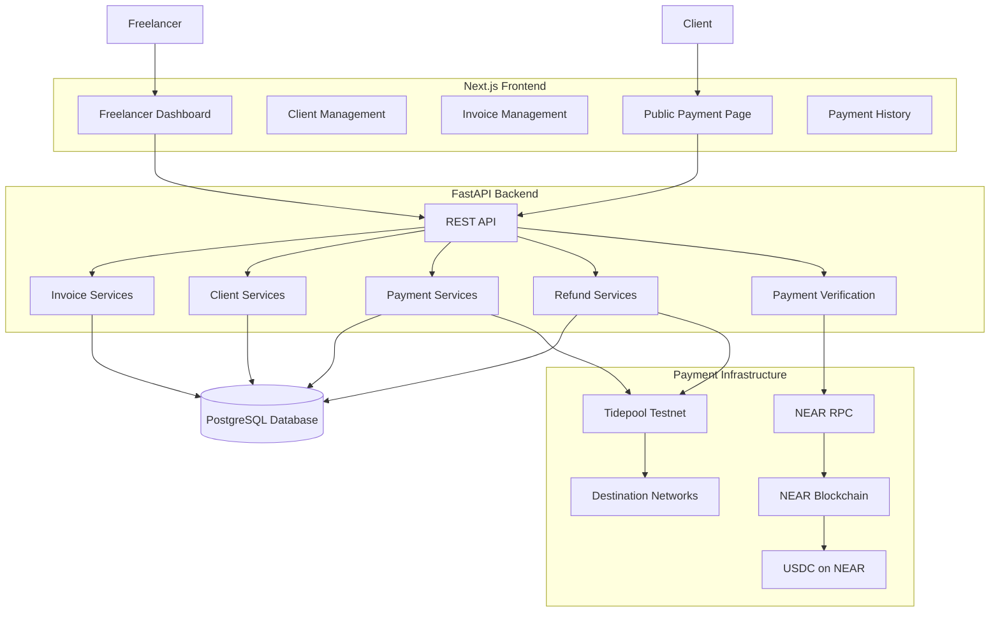
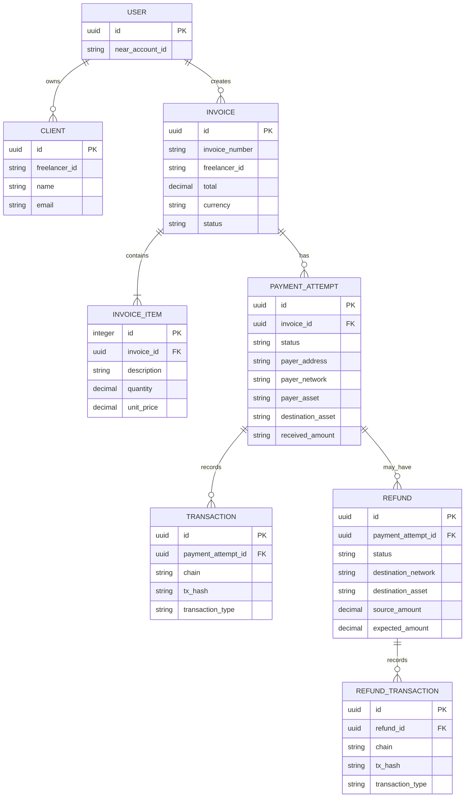
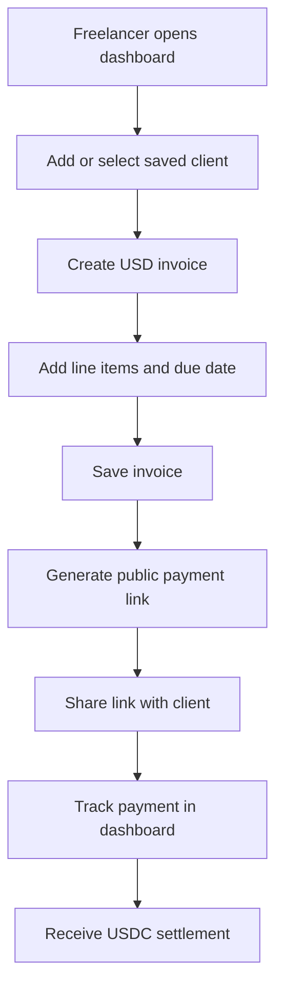
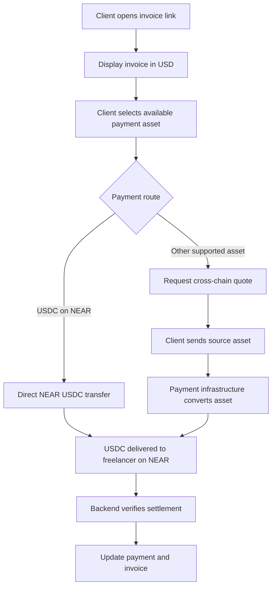

# PayFlow — Project Documentation

**Cross-chain invoicing with automatic USDC settlement on NEAR**

| Project detail | Information |
|---|---|
| Project | Hackathon Track 08 — Real-World Money |
| Version | 1.1 |
| Status | Working testnet prototype; security hardening in progress |
| Primary objective | Simple USD invoicing with automatic USDC settlement |

---

# 1. Project Overview

## 1.1 What is PayFlow?

PayFlow is a cross-chain invoicing platform designed to make cryptocurrency payments feel as simple as traditional invoicing.

Freelancers create invoices in USD and share payment links with their clients. Clients can pay using supported cryptocurrencies and networks, while PayFlow handles the payment routing, conversion, and settlement.

The freelancer receives USDC on NEAR, regardless of which supported asset the client uses to pay.

**The central idea is that users should not have to understand cryptocurrency infrastructure to use PayFlow.**

## 1.2 The Most Important Product Principle

> **Freelancers should not need to know anything about the cryptocurrency their clients use. They should simply invoice in USD and receive USDC.**

PayFlow is not intended to be a cryptocurrency management dashboard. It is an invoicing and payment application that uses blockchain infrastructure behind the scenes.

The intended experience is:

| User | What they need to understand |
|---|---|
| Freelancer | Create invoices in USD, share payment links, and receive USDC |
| Client | Open an invoice and pay using an available payment method |
| PayFlow | Handle token conversion, network routing, settlement, and verification |

For example:

- A freelancer creates an invoice for $100.
- The client pays using ETH.
- Another client might pay using BTC or SOL, where supported by the payment infrastructure.
- PayFlow routes and converts the payment.
- The freelancer receives the corresponding USDC settlement on NEAR.

The freelancer should not have to identify the source token, understand bridges, manually swap assets, or manage different blockchain networks.

**The dashboard should display familiar financial information: invoice amounts, payments, outstanding balances, and USDC receipts.**

Technical blockchain information may be available as optional transaction details, but it should not be required to understand or operate the application.

## 1.3 Problem Statement

Freelancers working internationally often encounter difficulties receiving payments:

- Traditional international transfers can be slow and expensive.
- Clients and freelancers may use different payment networks.
- Cryptocurrency payments introduce complexity around wallets, assets, and networks.
- Cross-chain transfers require additional infrastructure.
- Freelancers may not want to hold or manage multiple cryptocurrencies.

## 1.4 Solution

PayFlow provides:

- USD-denominated invoice creation.
- Client management and reusable client records.
- Shareable public invoice payment pages.
- Support for multiple payment assets and networks.
- Automatic conversion into USDC on NEAR.
- Payment tracking and invoice status management.
- Refund functionality for eligible payments.
- A unified dashboard for invoices, clients, and payments.

**Core principle: The client pays with what they have. The freelancer receives USDC.**

---

# 2. Technology Stack

## Frontend

| Technology | Purpose |
|---|---|
| Next.js 16 | Frontend framework |
| React 19 | UI components |
| TypeScript | Type safety |
| Tailwind CSS 4 | Styling |
| Next.js App Router | Page routing |

## Backend

| Technology | Purpose |
|---|---|
| Python | Backend language |
| FastAPI | REST API framework |
| SQLAlchemy | ORM and database operations |
| Pydantic | Request and response validation |
| PostgreSQL | Persistent database |

## Blockchain and Payment Infrastructure

| Technology | Purpose |
|---|---|
| NEAR Protocol | Freelancer settlement blockchain |
| USDC on NEAR | Standard freelancer settlement currency |
| Tidepool | Testnet cross-chain payment and conversion infrastructure |
| NEAR RPC | Blockchain transaction verification |
| Rust | NEAR smart contract development |
| NEP-366 | Meta-transaction infrastructure and relayer support |

**Testnet limitation:** The current Tidepool integration uses its sandbox environment and test tokens. These tokens have no monetary value. This integration is a test environment and should not be represented as an official production 1Click integration.

---

# 3. System Architecture

PayFlow follows a frontend-backend architecture with PostgreSQL and external blockchain/payment infrastructure.

## 3.1 High-Level Architecture



## 3.2 Component Responsibilities

### Frontend

- Display freelancer dashboard statistics.
- Create and manage invoices.
- Manage saved clients.
- Display public invoice payment pages.
- Present payment options to clients.
- Display payment and refund history.
- Provide clear status and transaction information.

### Backend

- Handle invoice and client operations.
- Create payment attempts.
- Request payment quotes and deposit instructions.
- Communicate with Tidepool.
- Interact with NEAR RPC.
- Verify payment and refund transactions.
- Manage payment and invoice statuses.
- Prevent duplicate payment processing.
- Provide reporting data.

### PostgreSQL

Stores persistent application data, including users, clients, invoices, invoice items, payment attempts, blockchain transactions, refunds, and refund transactions.

### Blockchain and Payment Infrastructure

Handles asset transfers, cross-chain conversion, destination settlement, and transaction verification.

---

# 4. Application Structure

The project is divided into frontend, backend, and blockchain contract components.

```text
payflow/
│
├── frontend/
│   ├── app/
│   │   ├── dashboard/
│   │   │   ├── page.tsx
│   │   │   ├── clients/
│   │   │   ├── invoices/
│   │   │   ├── payments/
│   │   │   └── reports/
│   │   │
│   │   └── pay/
│   │       └── [id]/
│   │
│   ├── lib/
│   │   ├── api.ts
│   │   ├── format.ts
│   │   ├── near-transfer.ts
│   │   └── types.ts
│   │
│   └── .env.local
│
├── backend/
│   ├── app/
│   │   ├── api/
│   │   │   ├── clients.py
│   │   │   ├── invoices.py
│   │   │   ├── payments.py
│   │   │   ├── refunds.py
│   │   │   ├── reports.py
│   │   │   └── relayer.py
│   │   │
│   │   ├── core/
│   │   │   ├── config.py
│   │   │   └── database.py
│   │   │
│   │   ├── models/
│   │   ├── schemas/
│   │   ├── integrations/
│   │   └── services/
│   │       ├── refund_service.py
│   │       ├── refund_reconciliation.py
│   │       └── ...
│   │
│   └── migrations/
│
└── contracts/
    └── payflow/
        └── ...
```

*This is a documentation-level representation, not a verified exhaustive listing of every current project file.*

---

# 5. Main Application Modules

## 5.1 Dashboard

The dashboard provides a simplified overview of the freelancer's invoicing activity.

Expected information:

- Total invoiced amount.
- Total paid amount.
- Outstanding amount.
- Invoice counts.
- Paid and pending invoice counts.
- Recent payment activity.

The dashboard should use USD-oriented financial terminology and avoid requiring users to understand blockchain-specific concepts.

## 5.2 Client Management

Freelancers can save and reuse client information.

Typical client fields:

| Field | Description |
|---|---|
| id | Unique client identifier |
| freelancer_id | Freelancer who owns the record |
| name | Client name |
| email | Client email |
| company | Optional company |
| notes | Additional information |
| created_at | Creation timestamp |

Supported operations include adding, listing, selecting, and deleting client records.

Client ownership and data isolation must be enforced by the backend.

## 5.3 Invoice Management

Invoices are denominated in USD.

An invoice contains:

- Invoice ID and invoice number.
- Freelancer ID.
- Client name and email.
- Line items.
- Total amount.
- Currency.
- Due date.
- Invoice status.
- Creation timestamp.
- Public payment URL.

Each invoice can contain multiple line items.

The invoice total is calculated from quantities and unit prices.

## 5.4 Payment Management

Payment attempts are separate from invoices because one invoice may have multiple payment attempts.

A payment attempt can store:

- Associated invoice.
- Payment attempt identifier.
- Source asset and network.
- Payer wallet information.
- Destination asset.
- Expected settlement amount.
- Deposit address and memo.
- Payment status.
- Associated blockchain transactions.

The original payer network, asset, and address are persisted so that the refund flow can use the original payment details without asking the freelancer to enter them again.

## 5.5 Refund Management

Refunds are separate records linked to payment attempts.

The intended refund flow is:

1. Freelancer selects Refund for an eligible payment.
2. PayFlow uses the original payer's network and wallet information.
3. The refund quote is generated.
4. The freelancer reviews the source amount and expected destination amount.
5. The freelancer approves and sends the refund.
6. PayFlow monitors the provider and destination settlement.
7. The refund history displays the verified result.

For cross-chain refunds, the freelancer sends the USDC received on NEAR, and the payer receives USDC on the original payment network.

The freelancer should not have to manually select a network, token, recipient address, or refund amount.

Refund verification and recovery remain an active development area; see Section 10.

## 5.6 Reports

The reporting module provides financial and operational summaries:

- Revenue.
- Invoice counts.
- Paid and pending amounts.
- Payment history.
- Date-filtered statistics.
- CSV exports, where implemented.

---

# 6. Database Architecture

The core database entities include:



The diagram represents conceptual relationships. In the current invoice creation flow, client details are copied into the invoice; a persistent invoice-to-client relationship should be verified before being assumed.

## 6.1 Invoice Statuses

| Status | Meaning |
|---|---|
| PENDING | Awaiting payment |
| PAID | Successfully settled |
| CANCELLED | Cancelled |
| EXPIRED | Expired |

## 6.2 Payment Statuses

| Status | Meaning |
|---|---|
| PENDING_DEPOSIT | Waiting for payer deposit |
| KNOWN_DEPOSIT_TX | Deposit transaction identified |
| INCOMPLETE_DEPOSIT | Deposit received but insufficient |
| PROCESSING | Payment being processed |
| SUCCESS | Payment successfully settled |
| DUPLICATE_SETTLEMENT | Additional successful payment for an already-paid invoice |
| FAILED | Payment failed |

## 6.3 Refund Statuses

| Status | Meaning |
|---|---|
| AWAITING_APPROVAL | Quote created; awaiting freelancer approval |
| PENDING | Refund submitted or awaiting processing |
| PROCESSING | Provider is processing the refund |
| REVIEW | Automated verification requires investigation |
| SUCCESS | Destination refund successfully verified |
| FAILED | Refund failed |

A `REVIEW` status must not be treated as a successful refund. It requires investigation and controlled reconciliation.

---

# 7. Freelancer Workflow



1. Freelancer opens the dashboard.
2. Freelancer creates or selects a saved client.
3. Freelancer creates an invoice.
4. Freelancer enters line items and prices.
5. PayFlow calculates the invoice total in USD.
6. The backend saves the invoice.
7. A public payment link is generated.
8. Freelancer shares the link with the client.
9. Freelancer tracks the payment from the dashboard.
10. PayFlow settles the payment in USDC on NEAR.

The freelancer should not need to interact with bridges, swaps, or source-chain payment details.

---

# 8. Client Payment Workflow

The client does not need access to the freelancer dashboard.

The client opens a public payment link, reviews the invoice, and chooses an available payment method.



The payment experience should make clear:

- Invoice value is shown in USD.
- The client sees the payment amount and available payment methods.
- Fees and estimated output should be disclosed before confirmation.
- The freelancer receives USDC on NEAR.
- A source-chain deposit alone does not prove successful settlement.

**Supported payment assets depend on the configured payment provider and its token registry. BTC, ETH, and SOL should only be advertised when the relevant network and asset are actually supported by the integrated infrastructure.**

---

# 9. Payment Architecture

PayFlow has two primary payment paths.

## 9.1 Direct USDC Payment on NEAR

When the payer already has USDC on NEAR, the client can make a direct token transfer.

The backend must verify:

1. Transaction success and finality.
2. Correct USDC token contract.
3. Correct recipient.
4. Correct transfer amount.
5. Transaction uniqueness.
6. Payment-attempt eligibility.

The NEP-141 token contract may require storage registration for the receiver. A direct `ft_transfer` also requires the appropriate one-yoctoNEAR attachment.

## 9.2 Cross-Chain Payment Through Tidepool

When the client uses another supported asset, Tidepool supplies a quote and deposit instructions.

Example:

- Invoice: $100.
- Client chooses a supported asset such as ETH.
- Tidepool provides a quote and deposit address.
- Client sends the quoted source asset.
- Tidepool processes the conversion.
- Freelancer receives USDC on NEAR.
- PayFlow verifies the destination settlement.

The deposit address is generated by the payment infrastructure and is not necessarily the freelancer's NEAR account.

**A source-chain deposit transaction does not, by itself, prove that the freelancer received USDC.**

---

# 10. Refund Architecture and Current Deferred Issue

## 10.1 Intended Refund Design

The refund flow is designed around the original payment details.

- Refunds are available for eligible successful payments and duplicate settlements.
- The payer's original network and wallet address are persisted during payment.
- The freelancer sends the full USDC amount received on NEAR.
- Cross-chain routing converts that USDC into USDC on the original payer network.
- The expected destination amount is displayed before approval.
- Fees and routing differences must be disclosed.
- Refund success is based on verified destination settlement, not merely wallet submission.

For cross-chain refunds, a Tidepool quote uses an exact-input approach so the full source amount is used.

## 10.2 Work Completed

- Added payer address, network, asset, and asset-decimal persistence to payment attempts.
- Added refund database models and refund transaction records.
- Added refund quote creation and approval flow.
- Added full-source-amount refund quote validation.
- Added destination USDC token lookup through the Tidepool token registry.
- Added protection against creating multiple active refunds for one payment attempt.
- Added refund transaction submission and reconciliation workflows.
- Added NEAR USDC receiver registration for cross-chain deposit addresses.
- Updated transaction verification to support the required storage-registration and transfer actions.
- Added refund history to the existing payment dashboard rather than creating a separate refunds page.
- Added refund ID display and recovery actions.
- Tested a cross-chain refund on Base Sepolia testnet.

## 10.3 Outstanding Refund Issue — Deferred

<ins>Current state: one cross-chain refund is in `REVIEW` and has not been reconciled successfully in the PayFlow database.</ins>

The Tidepool status response for the test refund reported:

- Provider status: `SUCCESS`.
- Source amount: `0.500000 USDC`.
- Reported destination output: `0.498700 USDC`.
- Base Sepolia payout transaction:
  `0xe2e5dc3df07a5ec514b5bfcb22e2afb918991b3e0f3b6f12af5c2cc75c35a117`.

However, backend reconciliation rejected the provider response because the original correlation ID was read from the wrong object.

### Identified code issue

The original quote is stored with this structure:

```python
{
    "quote": {...},
    "signature": "...",
    "timestamp": "...",
    "quoteRequest": {...},
    "correlationId": "..."
}
```

The helper:

```python
def _get_quote_details(refund):
    response = refund.quote_response or {}
    quote = response.get("quote", response)

    return response, quote
```

returns the outer response separately from the nested quote.

The existing reconciliation check incorrectly reads:

```python
original_quote.get("correlationId")
```

The identified correction is to read:

```python
original_response.get("correlationId")
```

### Additional identified issue

The provider response contains both NEAR execution transaction hashes and the destination Base payout hash.

The current implementation selects the first destination transaction entry. This can record a NEAR transaction as the Base settlement transaction.

The reconciliation code must select the actual destination-chain payout transaction using network-aware validation.

### Current limitations

- The existing refund is still marked `REVIEW`.
- The database has no successful refund transaction record for this refund.
- The correlation ID extraction correction has been identified but still needs to be applied and tested.
- The destination transaction selection needs correction.
- A controlled recovery path is needed for refunds already in `REVIEW`.
- The provider response included an HTTP 429 note; provider/API reliability and retry behavior should also be investigated.

**Deferred decision:** No additional transfer or new refund quote should be created for this existing refund while the reconciliation issue remains unresolved. The refund should not be manually marked `SUCCESS` without passing the required verification checks.

---

# 11. Security and Payment Integrity

Payment verification is one of the most important parts of PayFlow.

A submitted transaction hash must never be treated as proof of payment by itself.

## 11.1 Potential Attacks

| Attack | Description |
|---|---|
| Fake transaction hash | Payer submits an unrelated or fabricated hash |
| Replay attack | Same transaction is submitted more than once |
| Wrong recipient | Transfer is sent to an unintended account |
| Wrong token | Unsupported token is transferred |
| Underpayment | Received amount is lower than required |
| Unconfirmed transaction | Transaction has not reached required finality |
| Double crediting | One settlement is credited more than once |
| Cross-user access | User accesses another freelancer's records |
| Duplicate refund | Multiple refunds are initiated for one payment |

## 11.2 Required Verification

For direct NEAR USDC payments:

1. Query a trusted NEAR RPC endpoint.
2. Verify transaction success and finality.
3. Inspect the actual token transfer.
4. Verify the USDC token contract.
5. Verify recipient and amount.
6. Check transaction uniqueness.
7. Record the verified transaction.
8. Update payment and invoice state atomically.

For cross-chain payments:

1. Associate the payment attempt with its original provider quote and intent.
2. Retrieve provider execution status.
3. Verify the provider response against the original quote.
4. Independently verify destination settlement where supported.
5. Verify destination token, recipient, and amount.
6. Check destination transaction uniqueness.
7. Update the payment attempt and invoice atomically.

For refunds, the same principle applies: a wallet submission or provider status alone must not cause an unverified refund to be marked successful.

## 11.3 Replay Protection and Atomic Settlement

The database should prevent a blockchain transaction from being credited more than once.

A uniqueness constraint should be used for the appropriate chain and transaction identifier.

Payment processing should be idempotent. Reprocessing the same verified transaction must not create another payment credit.

Payment-attempt and invoice status changes should be protected by database transactions and appropriate row-level locking or concurrency controls.

---

# 12. API Architecture

The frontend communicates with the backend through REST APIs.

The API base URL is configured through `NEXT_PUBLIC_API_URL`.

| API group | Responsibility |
|---|---|
| `/api/clients/` | Client management |
| `/api/invoices/` | Invoice creation and management |
| `/api/payments/` | Payment attempts and operations |
| `/api/refunds/` | Refund quotes, approval, submission, and reconciliation |
| `/api/reports/` | Reporting and statistics |
| `/api/relayer/` | Relayer-related operations |

The backend should enforce authentication, ownership, and request validation for protected endpoints.

API documentation should be checked against the current FastAPI route definitions before being used as an integration contract.

---

# 13. Environment Configuration

## Frontend

Example `.env.local`:

```env
NEXT_PUBLIC_API_URL=http://127.0.0.1:8000/api
```

## Backend

Relevant testnet configuration:

```env
NEAR_INTENTS_BASE_URL=https://www.usetidepool.tech
USDC_ASSET_ID=nep141:usdc.tidepool-sandbox.testnet
USDC_DECIMALS=6
NEAR_RPC_URL=https://rpc.testnet.near.org
```

Actual configuration variable names should be verified against `backend/app/core/config.py`.

Private credentials and API secrets must remain in backend environment variables. Never expose private keys or privileged credentials through `NEXT_PUBLIC_` variables.

## Token Amounts

Token amounts must use integer base units or exact decimal arithmetic.

| Token | Decimals |
|---|---:|
| USDC | 6 |
| wNEAR | 24 |

For USDC:

`1 USDC = 1,000,000 base units`

For wNEAR:

`1 wNEAR = 1,000,000,000,000,000,000,000,000 base units`

Floating-point arithmetic must not be used for settlement calculations.

---

# 14. Development Progress

## Completed or demonstrated

- [x] Next.js frontend and FastAPI backend.
- [x] PostgreSQL integration.
- [x] Dashboard and invoice management.
- [x] Client creation, listing, and deletion.
- [x] Client selection during invoice creation.
- [x] USD-denominated invoices and line items.
- [x] Public invoice payment page.
- [x] Payment attempt records.
- [x] Direct NEAR USDC payment flow tested.
- [x] Tidepool testnet cross-chain payment flow tested.
- [x] wNEAR-to-USDC testnet conversion demonstrated.
- [x] Freelancer USDC destination settlement observed.
- [x] Payment and invoice dashboard integration.
- [x] Payer details persisted for refund routing.
- [x] Refund quote and approval workflow implemented.
- [x] Cross-chain refund wallet transfer tested.
- [x] Receiver storage registration handled for cross-chain refund deposits.
- [x] Refund history integrated into the payment dashboard.

## In progress or requiring further verification

- [ ] Complete identity and access-control audit.
- [ ] Complete payment verification and settlement regression testing.
- [ ] Validate all duplicate-settlement scenarios.
- [ ] Verify transaction uniqueness constraints and idempotency.
- [ ] Verify atomic payment and invoice updates under concurrency.
- [ ] Complete refund reconciliation and recovery.
- [ ] Correct destination-chain transaction selection.
- [ ] Test refund failure, retry, and review scenarios.
- [ ] Test underpayment and overpayment handling.
- [ ] Review API rate limits and request validation.
- [ ] Complete database migration and backup procedures.
- [ ] Add structured logging and monitoring.

---

# 15. PayFlow Security Roadmap

The roadmap is divided into six phases. Priorities indicate implementation order and importance.

## Phase 1 — Identity and Access

<ins>Priority: P0</ins>

The objective is to ensure users can only access and modify their own application data.

Tasks:

- Wallet authentication.
- Session management.
- Freelancer ownership checks.
- Secure invoice and client CRUD.
- Protect reports and dashboard endpoints.
- Enforce ownership on payment and refund operations.
- Verify that public invoice access exposes only intended information.

**Exit criteria:** Authenticated users cannot access or modify another freelancer's private records.

**Status:** Requires a complete end-to-end security audit before being considered closed.

## Phase 2 — Payment Integrity

<ins>Priority: P0</ins>

The objective is to ensure every payment credited by PayFlow represents a real, verified settlement.

Tasks:

- Strengthen direct NEAR transaction verification.
- Independently verify cross-chain settlement.
- Add database constraints.
- Implement atomic settlement.
- Improve payment state transitions.
- Prevent duplicate transaction crediting.
- Handle multiple successful payment attempts for one invoice.
- Improve payment reconciliation.
- Complete refund reconciliation and recovery.

**Exit criteria:** Payments and refunds are only marked successful after their settlement evidence has been verified. Duplicate processing cannot create duplicate credits.

**Status:** In progress. Payment and refund flows have been implemented and tested on testnet, but additional verification and reconciliation work remains.

## Phase 3 — Infrastructure Protection

<ins>Priority: P1</ins>

The objective is to protect the backend and its supporting infrastructure.

Tasks:

- Rate limiting.
- API validation.
- Secret management.
- Database migrations and backups.
- Logging and monitoring.
- Provider timeout and retry handling.
- Secure error handling.
- Database connection and availability management.

**Exit criteria:** The application has documented infrastructure controls, recoverable database backups, and sufficient observability for operational failures.

**Status:** Planned.

## Phase 4 — Contract and Relayer

<ins>Priority: P1</ins>

The objective is to strengthen the on-chain and relayer components.

Tasks:

- Improve settlement validation.
- Strengthen delegate-action verification.
- Secure admin authority.
- Test replay protection.
- Review relayer permissions and transaction authorization.
- Test failure and recovery scenarios.

**Exit criteria:** Contract and relayer operations have verified authorization, replay protection, and documented security tests.

**Status:** Planned.

## Phase 5 — Mainnet Migration

<ins>Priority: P2</ins>

The objective is to move from sandbox infrastructure to production-ready payment infrastructure.

Tasks:

- Official 1Click integration.
- Mainnet USDC configuration.
- Contract deployment.
- Production relayer.
- Mainnet integration testing.
- Production RPC and provider configuration.
- Review network-specific fees and token support.

**Exit criteria:** All production components are deployed and tested with controlled mainnet transactions.

**Status:** Not started. Current implementation uses testnet infrastructure.

## Phase 6 — Controlled Launch

<ins>Priority: Final</ins>

The objective is to launch PayFlow gradually with operational and security safeguards.

Tasks:

- External security review.
- Small-value real payments.
- Reconciliation monitoring.
- Gradual rollout.
- Incident response procedures.
- Operational monitoring and support.

**Exit criteria:** External review findings are addressed, real-payment monitoring is operational, and the rollout has defined safety limits.

**Status:** Not started.

---

# 16. Recommended Next Steps

The following order is recommended when development resumes.

| Order | Task | Reason |
|---:|---|---|
| 1 | Audit Phase 1 identity and access controls | User isolation is foundational |
| 2 | Complete Phase 2 payment verification | Prevent incorrect payment crediting |
| 3 | Fix and retest refund reconciliation | Existing refund flow has an unresolved REVIEW case |
| 4 | Test duplicate and concurrent settlements | Prevent double crediting |
| 5 | Test payment and refund failure recovery | Ensure safe state transitions |
| 6 | Add Phase 3 infrastructure controls | Improve production readiness |
| 7 | Complete contract and relayer review | Protect privileged on-chain operations |
| 8 | Integrate production payment infrastructure | Prepare for mainnet |
| 9 | Perform external review and controlled launch | Reduce launch risk |

## Immediate Deferred Work

The following items should be retained for the next development session:

1. Fix the original refund correlation ID extraction in `refund_reconciliation.py`.
2. Select the correct destination-chain transaction hash instead of the first provider transaction entry.
3. Implement a safe recovery path for refunds already in `REVIEW`.
4. Reconcile the existing Base Sepolia refund without submitting another transfer.
5. Test refund success, failure, retry, and duplicate-submission behavior.
6. Confirm the final refund transaction is stored correctly and reflected in the dashboard.

---

# 17. Product UX Requirements

These requirements should guide future frontend and backend changes.

1. Invoices are denominated in USD.
2. Freelancers receive USDC on NEAR.
3. Clients can pay using supported assets and networks.
4. PayFlow handles conversion and routing automatically.
5. Freelancers should not have to choose a refund destination network or enter the payer's address manually.
6. The dashboard should not require knowledge of token symbols, blockchain explorers, bridges, or gas.
7. Technical transaction information should be optional and secondary.
8. Fees and expected payment/refund amounts should be clear before approval.
9. Pending, processing, successful, failed, and review states must be communicated clearly.
10. A submitted transaction must never be presented as a completed settlement before verification.

The goal is to make PayFlow feel like a normal invoicing product, not a cryptocurrency trading interface.

---

# 18. Conclusion

PayFlow aims to simplify international invoicing and cross-chain cryptocurrency payments by separating the user experience from blockchain complexity.

Freelancers create familiar USD invoices and receive USDC on NEAR. Clients can pay using supported assets and networks. PayFlow handles routing, conversion, and settlement behind the scenes.

The prototype demonstrates direct NEAR USDC payments, cross-chain testnet conversion, payment tracking, and a refund workflow.

The next engineering priority is to complete the security roadmap, especially identity isolation, payment integrity, independent settlement verification, and reliable refund reconciliation.

Production deployment must wait until the security and infrastructure requirements have been tested and satisfied.

**PayFlow — Invoices in dollars. Payments across chains. Settlement in USDC.**