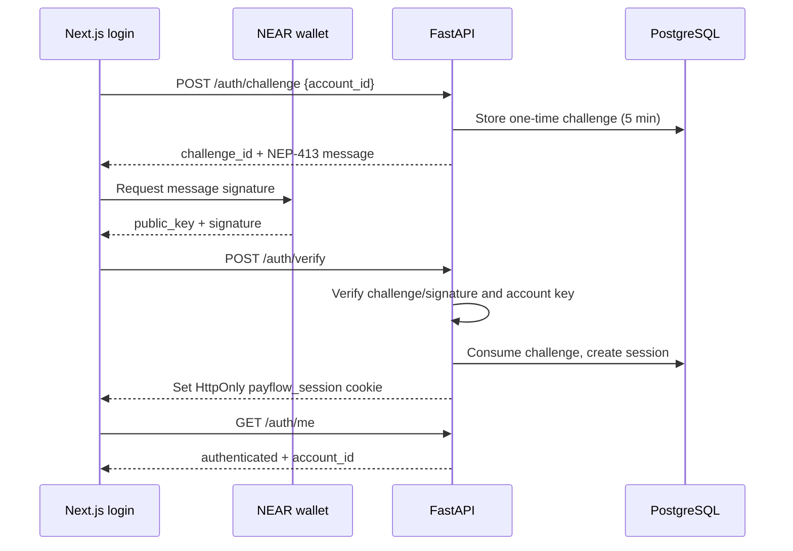
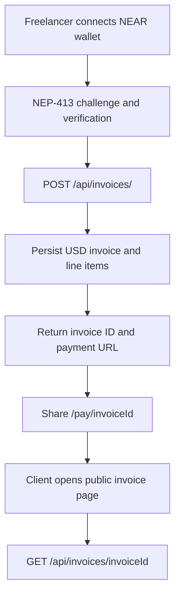
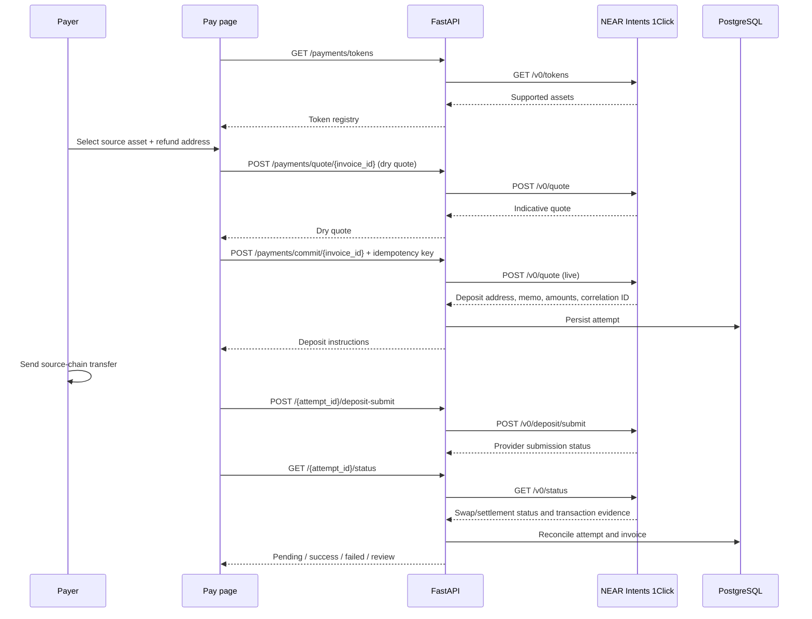
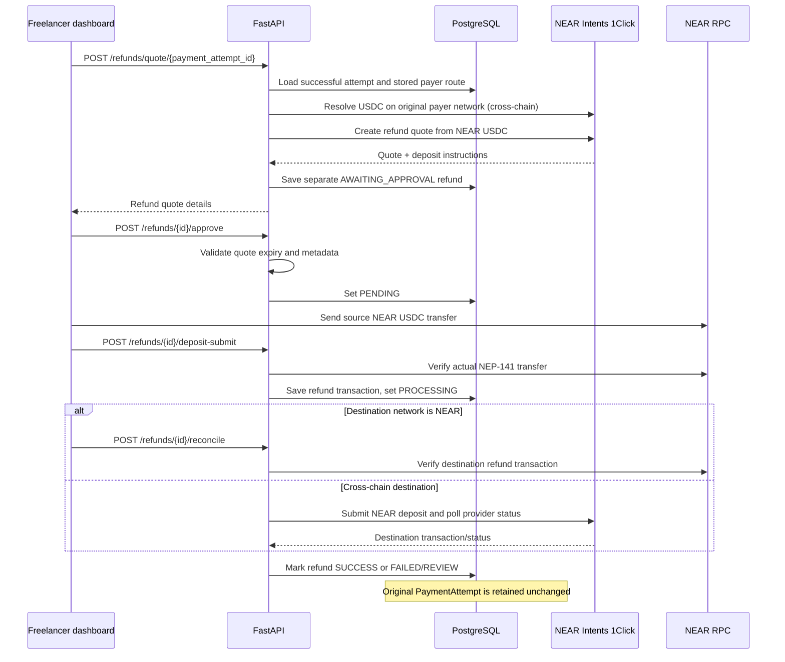
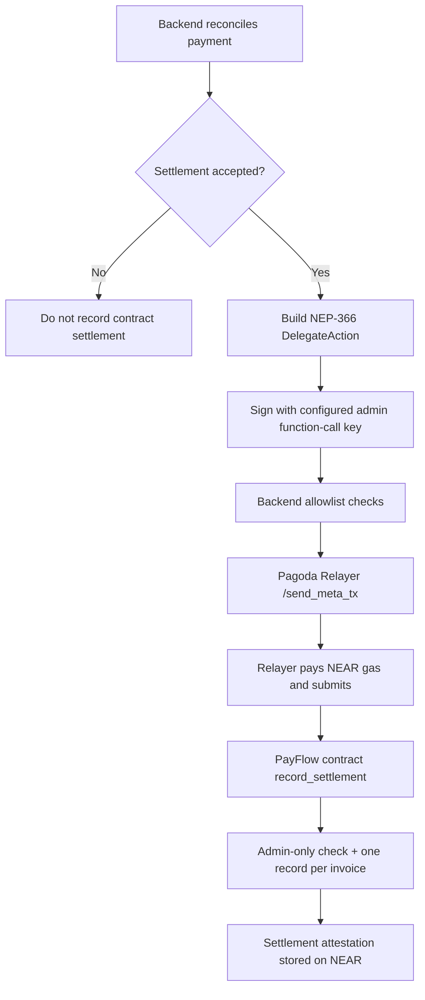

# PayFlow API & Frontend Reference

> Source of truth: router and schema code in `backend/app/api/`, `backend/app/schemas/`, and frontend calls in `frontend/app/` and `frontend/lib/`. Backend routes are mounted under `/api`.

## 1. Conventions

- Base URL (local): `http://localhost:8000/api`
- JSON request/response unless noted.
- Frontend `apiRequest()` sends `credentials: "include"` and `cache: "no-store"`.
- Freelancer-authenticated endpoints use the `payflow_session` HttpOnly cookie.
- Public invoice/payment endpoints intentionally do not require a freelancer session so a payer can pay from a shared link.
- IDs are UUID strings unless noted.
- Monetary values should be treated as decimal strings or integer base units, not JavaScript floating-point values.
- The configured NEAR USDC asset uses 6 decimals: `1 USDC = 1000000` base units. The backend reads the configured asset ID and decimal precision from environment settings.
- Rate-limited routes return the framework's rate-limit response when the configured limit is exceeded.

## 2. Endpoint index

| Method | Endpoint | Auth | Purpose |
|---|---|---|---|
| GET | `/` | No | Backend identity/status |
| GET | `/health` | No | Health check |
| POST | `/auth/challenge` | No | Issue NEP-413 challenge |
| POST | `/auth/verify` | No | Verify wallet signature; set session cookie |
| GET | `/auth/me` | Yes | Current freelancer |
| POST | `/auth/logout` | No cookie required | Revoke session and clear cookie |
| POST | `/invoices/` | Yes | Create invoice |
| GET | `/invoices/` | Yes | List freelancer invoices |
| GET | `/invoices/{invoice_id}` | No | Public invoice/payment-page data |
| GET | `/invoices/{invoice_id}/manage` | Yes | Freelancer-owned invoice detail |
| GET | `/clients/` | Yes | List clients |
| POST | `/clients/` | Yes | Create client |
| GET | `/clients/{client_id}` | Yes | Get client |
| PATCH | `/clients/{client_id}` | Yes | Update client |
| DELETE | `/clients/{client_id}` | Yes | Delete client |
| GET | `/payments/tokens` | No | Provider-supported token registry |
| GET | `/payments/` | Yes | Freelancer payment history |
| POST | `/payments/quote/{invoice_id}` | No | Request dry quote (query parameters) |
| POST | `/payments/direct/{invoice_id}` | No | Create direct NEAR USDC attempt |
| POST | `/payments/commit/{invoice_id}` | No | Create live provider quote/payment attempt |
| POST | `/payments/{attempt_id}/deposit-submit` | No | Submit payer transaction hash |
| GET | `/payments/{attempt_id}/status` | No | Reconcile payment status |
| POST | `/refunds/quote/{payment_attempt_id}` | Yes | Create full refund quote to original payer route |
| POST | `/refunds/{refund_id}/approve` | Yes | Approve quote |
| POST | `/refunds/{refund_id}/deposit-submit` | Yes | Submit refund source transfer hash |
| POST | `/refunds/{refund_id}/reconcile` | Yes | Reconcile refund |
| GET | `/refunds/{refund_id}` | Yes | Refund detail and transactions |
| GET | `/refunds` | Yes | List freelancer refunds |
| GET | `/reports/invoices/csv` | Yes | Download invoice CSV |
| POST | `/relayer/submit` | Internal API key | Submit validated signed delegate action |

## 3. Authentication

### `POST /auth/challenge`

Request:

```json
{ "account_id": "<FREELANCER_NEAR_ACCOUNT_ID>" }
```

Returns a challenge object containing `challenge_id`, `account_id`, `message`, `nonce`, `recipient`, `callback_url` and `expires_at`.

The challenge is short-lived (5 minutes in the current implementation). The frontend asks the connected NEAR wallet to sign the NEP-413 message.

### `POST /auth/verify`

Request:

```json
{
  "challenge_id": "<uuid>",
  "account_id": "<FREELANCER_NEAR_ACCOUNT_ID>",
  "public_key": "ed25519:<public-key>",
  "signature": "<wallet-signature>"
}
```

On success returns:

```json
{
  "authenticated": true,
  "account_id": "<FREELANCER_NEAR_ACCOUNT_ID>",
  "expires_at": "<ISO-8601 timestamp>"
}
```

Also sets `payflow_session` as an HttpOnly cookie. The cookie is `SameSite=Lax`; `Secure` follows `AUTH_COOKIE_SECURE`; max age follows `AUTH_SESSION_DAYS`.

### `GET /auth/me`

Requires the session cookie.

```json
{ "authenticated": true, "account_id": "<FREELANCER_NEAR_ACCOUNT_ID>" }
```

### `POST /auth/logout`

Revokes the session if present and clears the cookie.

**Security note:** NEP-413 here authenticates the freelancer to PayFlow. It is not blanket authorization for unrelated wallet transactions.

## 4. Invoices

### `POST /invoices/`

Requires freelancer session.

Request:

```json
{
  "client_name": "Example Client",
  "client_email": "accounts@example.com",
  "due_date": "2026-11-20T00:00:00Z",
  "items": [
    {
      "description": "Website design",
      "quantity": "1",
      "unit_price": "125.00"
    },
    {
      "description": "Maintenance",
      "quantity": "2",
      "unit_price": "25.00"
    }
  ]
}
```

Returns `id`, `invoice_number`, `total`, `currency`, `status` and `payment_url`. The invoice is denominated in USD and begins in `PENDING`.

### `GET /invoices/`

Requires freelancer session. Returns that freelancer's invoices, newest first. Each serialized invoice includes invoice/client fields, USD total, status, due date, public `payment_url`, and line items.

### `GET /invoices/{invoice_id}`

Public endpoint used by `/pay/[invoiceId]`. Returns invoice and line items, including the freelancer NEAR account ID needed to display/route payment information. A valid UUID that does not exist returns 404.

### `GET /invoices/{invoice_id}/manage`

Requires freelancer session and ownership. Returns the same invoice serialization but only if it belongs to the authenticated freelancer; otherwise 404.

There are currently no invoice update or delete routes.

## 5. Clients

All client routes require freelancer session and are scoped to the authenticated freelancer's NEAR account.

### `GET /clients/`

Returns the current freelancer's clients.

### `POST /clients/`

Request:

```json
{
  "name": "Example Client",
  "email": "accounts@example.com",
  "company": "Example Co",
  "notes": "Monthly retainer"
}
```

Returns the created client (201).

### `GET /clients/{client_id}`

Returns one owned client or 404.

### `PATCH /clients/{client_id}`

Accepts any subset of `name`, `email`, `company`, `notes`.

### `DELETE /clients/{client_id}`

Deletes an owned client; returns 204.

## 6. Payments

### `GET /payments/tokens`

Public. Proxies the provider token registry (`GET /v0/tokens`). The frontend uses it to show available networks/tokens. The returned token list is provider-defined; do not hard-code availability.

### `GET /payments/`

Requires freelancer session. Lists attempts belonging to invoices owned by the freelancer. Includes invoice number/client, attempt status, deposit address/memo, source/destination assets, expected/received amounts, payer network/address/asset metadata and transaction records.

### `POST /payments/quote/{invoice_id}`

Public dry quote endpoint. Query parameters:

- `source_asset` — provider asset ID
- `refund_address` — payer address used by the quote

Example:

```bash
curl -X POST \
  "http://localhost:8000/api/payments/quote/<INVOICE_UUID>?source_asset=<ASSET_ID>&refund_address=<PAYER_ADDRESS>"
```

This asks the provider for a dry quote (`dry=true` in the service). It does not create a persisted payment attempt. Returns the provider quote response.

### `POST /payments/direct/{invoice_id}`

Public direct NEAR USDC attempt creation. Requires header:

```text
Idempotency-Key: <unique-key-at-least-8-characters>
```

Example:

```bash
curl -X POST "http://localhost:8000/api/payments/direct/<INVOICE_UUID>" \
  -H "Idempotency-Key: direct-demo-0001"
```

Creates a `PENDING_DEPOSIT` attempt using the configured NEAR NEP-141 USDC asset and freelancer account as recipient. The returned object includes `payment_attempt_id`, `deposit_address` (an internal `direct-near:<uuid>` marker, not a wallet address), `expected_amount`, `destination_asset`, `payment_mode` and `quote`.

### `POST /payments/commit/{invoice_id}`

Public cross-chain provider attempt creation. Query parameters:

- `source_asset`
- `refund_address`

Header: `Idempotency-Key` (8–128 characters).

Example:

```bash
curl -X POST \
  "http://localhost:8000/api/payments/commit/<INVOICE_UUID>?source_asset=<ASSET_ID>&refund_address=<PAYER_ADDRESS>" \
  -H "Idempotency-Key: cross-demo-0001"
```

The backend obtains a live provider quote (`dry=false`), validates that its destination asset/recipient match the invoice's configured USDC recipient, persists the attempt and returns deposit instructions plus quote data. A repeated request with the same key returns the existing attempt if the original invoice/source asset/refund address match.

### `POST /payments/{attempt_id}/deposit-submit`

Public endpoint called after the payer has made the source-chain transfer. Request:

```json
{
  "tx_hash": "<origin-transaction-hash>",
  "near_sender_account": "<PAYER_NEAR_ACCOUNT_ID>",
  "payer_address": "payer-wallet-address",
  "payer_network": "near",
  "payer_asset": "<NEAR_MAINNET_USDC_ASSET_ID>",
  "payer_asset_decimals": 6
}
```

Fields vary by payment route:
- Direct NEAR requires `near_sender_account`, `payer_address` matching that account, `payer_network="near"`, and the configured NEAR USDC asset/decimals.
- Cross-chain requires payer address/network/asset matching the quote and the provider token registry. The NEAR sender account is optional and is supplied when the source transfer is a NEAR transfer.

The backend rejects duplicate transaction hashes across attempts. For direct NEAR, it records the transaction and moves the attempt to `PROCESSING`; NEAR RPC reconciliation verifies signer, token contract, `ft_transfer`, recipient, amount and NEP-141 event. For cross-chain, the backend submits the origin hash to the provider deposit-submit endpoint and records the provider response.

### `GET /payments/{attempt_id}/status`

Public reconciliation endpoint. Direct NEAR attempts are checked against NEAR RPC. Cross-chain attempts are checked through provider status. Returns payment attempt status, invoice status, received amount and transaction/contract-recording details as applicable.

**Status behaviour:** `PENDING_DEPOSIT`, `KNOWN_DEPOSIT_TX`, `INCOMPLETE_DEPOSIT` and `PROCESSING` are active/in-progress states. Final or review states include `SUCCESS`, `REFUNDED`, `FAILED`, `DUPLICATE_SETTLEMENT` and `SETTLEMENT_REVIEW` as implemented by reconciliation.

Multiple attempts per invoice are allowed. The invoice's paid-attempt guard prevents a later attempt from silently replacing an already accepted settlement.

## 7. Refunds

Refund routes require freelancer authentication and verify that the linked invoice belongs to the current freelancer.

### `POST /refunds/quote/{payment_attempt_id}`

Optional header:

```text
Idempotency-Key: <unique-refund-key>
```

No JSON body is required by the current route. The backend reads the original payer's stored `payer_network`, `payer_address`, `payer_asset` and decimals from the successful payment attempt. It resolves USDC on that original network and creates a full refund quote from the configured NEAR USDC source asset.

Only `SUCCESS` or `DUPLICATE_SETTLEMENT` attempts with complete original payer metadata and a positive received amount can be refunded. Current logic allows only one full refund per payment attempt, subject to safe retry/reconciliation rules.

### `POST /refunds/{refund_id}/approve`

No body. Approves the saved quote. Cross-chain quote deadline and required provider metadata are validated before approval. Returns the refund ID/status, source/destination assets, destination address, amounts and deposit details.

### `POST /refunds/{refund_id}/deposit-submit`

Request:

```json
{
  "tx_hash": "<NEAR-USDC-transfer-hash>",
  "near_sender_account": "<FREELANCER_NEAR_ACCOUNT_ID>"
}
```

The backend verifies the actual NEP-141 source transfer before persisting it. For direct NEAR refunds, the transfer is verified and then reconciled against NEAR RPC. For cross-chain refunds, the verified NEAR transfer is submitted to the provider's deposit-submit endpoint. If provider submission needs retry, retry with the same transaction hash; do not send another transfer.

### `POST /refunds/{refund_id}/reconcile`

No body. Calls direct NEAR or cross-chain refund reconciliation based on destination network. A refund remains `PROCESSING` until the destination transfer/status is verified.

### `GET /refunds/{refund_id}` and `GET /refunds`

Require freelancer session. Detail includes provider response, timestamps and refund transaction records (chain, hash, type, asset, amount and explorer URL). List returns the current freelancer's refunds.

Refunds are separate from payments. The original payment row is retained unchanged.

## 8. CSV report

### `GET /reports/invoices/csv`

Requires freelancer session. Returns `text/csv` as an attachment:

```text
payflow_invoices.csv
```

The frontend downloads the response as a Blob. It is UTF-8 with BOM for spreadsheet compatibility.

## 9. Relayer endpoint

### `POST /relayer/submit`

Requires `X-Internal-API-Key` matching `INTERNAL_API_KEY`. This is an internal backend endpoint, not a browser endpoint.

Request:

```json
{
  "delegate_action": {
    "sender_id": "<PAYFLOW_CONTRACT_ADMIN_ID>",
    "receiver_id": "<PAYFLOW_CONTRACT_ID>",
    "actions": [
      {
        "FunctionCall": {
          "method_name": "record_settlement",
          "args": "<base64-encoded-json-args>",
          "gas": "100000000000000",
          "deposit": "0"
        }
      }
    ],
    "nonce": 1,
    "max_block_height": 123456789,
    "public_key": "ed25519:<function-call-public-key>"
  },
  "signature": "ed25519:<delegate-action-signature>"
}
```

Validation rules:
- `sender_id` must equal configured `PAYFLOW_CONTRACT_ADMIN_ID`.
- `receiver_id` must equal configured `PAYFLOW_CONTRACT_ID`.
- Exactly one action is accepted.
- It must be a function call to `record_settlement`.
- Attached deposit must be zero.
- Gas must be positive and no greater than `RELAYER_MAX_GAS`.

The reconciliation service normally builds and submits the signed action through the `near_relayer` integration directly. The route above is the separately exposed internal relay endpoint.

## 10. Frontend route map

| Browser route | Access | Purpose | Main backend calls |
|---|---|---|---|
| `/` | Public | Landing/redirect | — |
| `/login` | Public | Connect NEAR wallet and authenticate | `POST /auth/challenge`, `POST /auth/verify` |
| `/dashboard` | Freelancer | Overview | `GET /invoices/` |
| `/dashboard/invoices` | Freelancer | Invoice list and CSV export | `GET /invoices/`, `GET /reports/invoices/csv` |
| `/dashboard/invoices/new` | Freelancer | Create invoice | `GET /clients/`, `POST /invoices/` |
| `/dashboard/invoices/[id]` | Freelancer | Manage invoice | `GET /invoices/{id}/manage` |
| `/dashboard/payments` | Freelancer | Payment history and refund actions | `GET /payments/`, refund endpoints |
| `/dashboard/clients` | Freelancer | Client CRUD | `/clients/` |
| `/dashboard/settings` | Freelancer | Session/account details | `GET /auth/me`, `POST /auth/logout` |
| `/pay/[invoiceId]` | Public | Client-facing invoice/payment | `GET /invoices/{id}`, `GET /payments/tokens`, payment quote/attempt/submit/status |

The current frontend does not expose invoice update/delete endpoints because those backend routes do not exist.

## 11. Core flow diagrams

### A. Wallet authentication



### B. Invoice creation and share link



### C. Direct NEAR USDC payment

```mermaid
sequenceDiagram
    participant P as Payer browser/wallet
    participant API as FastAPI
    participant DB as PostgreSQL
    participant RPC as NEAR RPC
    participant C as PayFlow contract
    participant R as Pagoda Relayer

    P->>API: GET public invoice + GET /payments/tokens
    P->>API: POST /payments/direct/{invoice_id} + Idempotency-Key
    API->>DB: Create PENDING_DEPOSIT attempt
    API-->>P: attempt ID + expected USDC base units
    P->>P: Sign and send NEP-141 ft_transfer to freelancer
    P->>API: POST /{attempt_id}/deposit-submit (tx hash + payer)
    API->>DB: Store transaction; mark PROCESSING
    P->>API: GET /{attempt_id}/status
    API->>RPC: Fetch transaction and receipt outcomes
    RPC-->>API: Signer, receiver, action, NEP-141 event
    API->>API: Verify sender, token contract, recipient, amount, success
    API->>DB: Mark attempt SUCCESS and invoice PAID (atomic guard)
    API->>API: Build/sign NEP-366 DelegateAction
    API->>R: POST /send_meta_tx
    R->>C: Submit transaction; pay gas
    C-->>R: Settlement record result
    R-->>API: Relayer result
    API-->>P: SUCCESS + invoice status + transaction details
```

### D. Cross-chain payment through provider



### E. Refund to original payer route



### F. Meta-transaction settlement recording



## 12. What the implementation does not claim

- A backend-reported provider `SUCCESS` is not the same thing as a trustless on-chain proof of the foreign-chain swap.
- The contract's settlement entry is a backend-submitted record/attestation, not an independent cross-chain verifier.
- The current app is not a production accounting or custody system.
- Public payment endpoints are intentionally unauthenticated to support payers who do not have PayFlow freelancer accounts. Rate limits, UUID validation, provider checks, idempotency and settlement guards are part of abuse/error handling, but production abuse protection needs further review.
